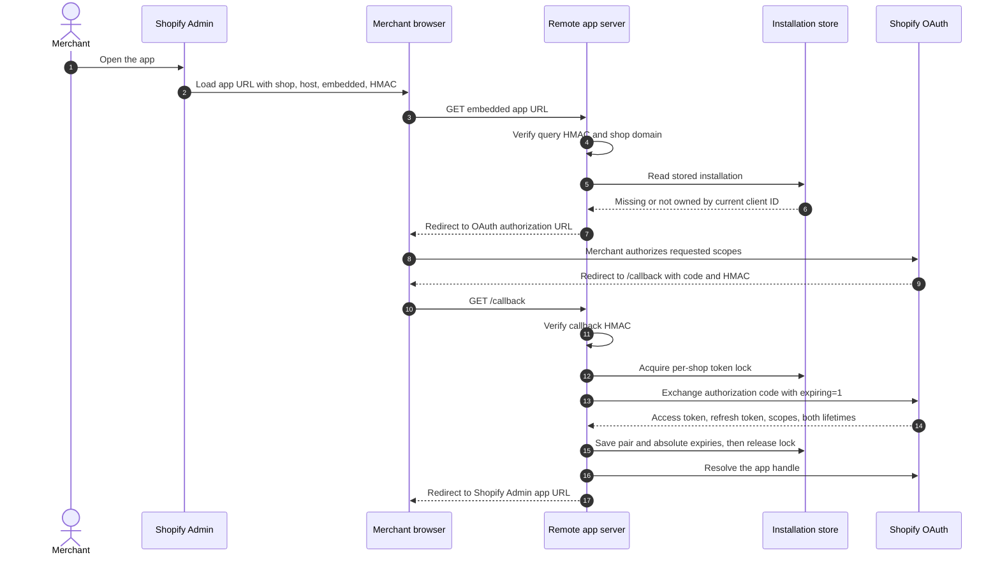
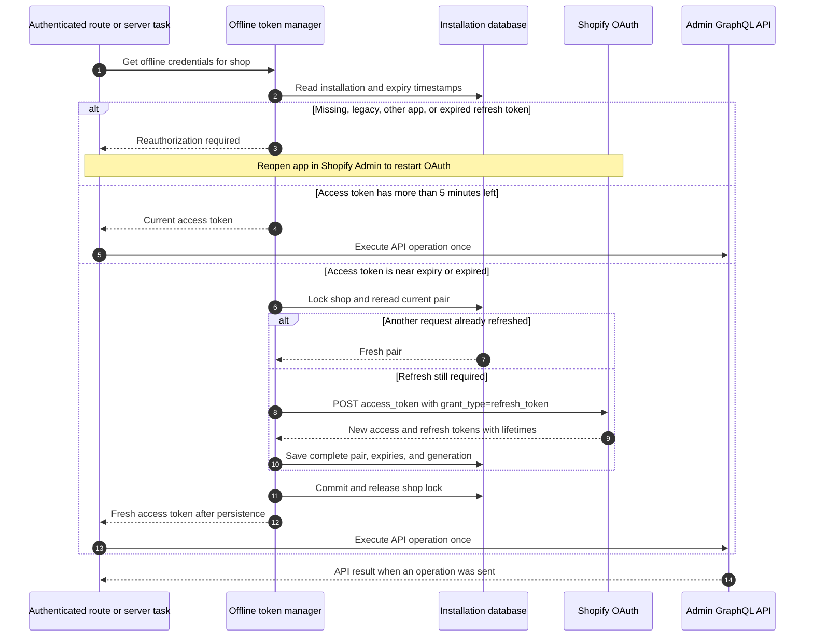
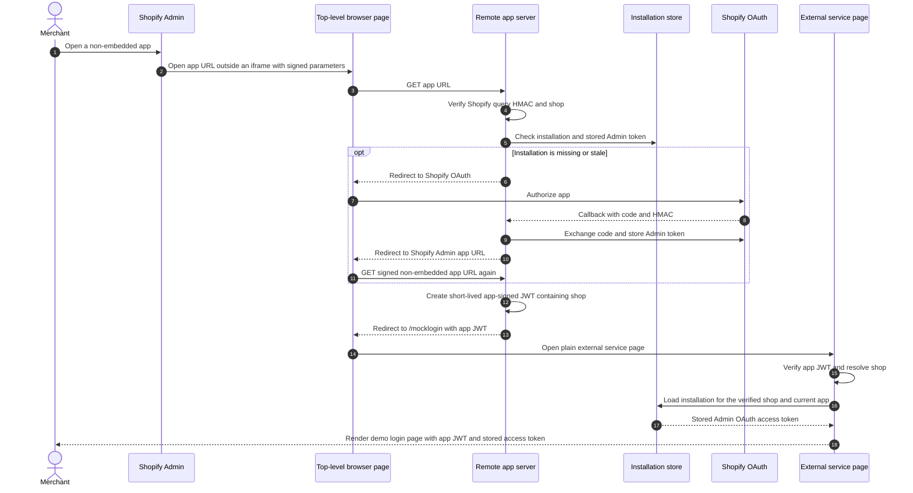
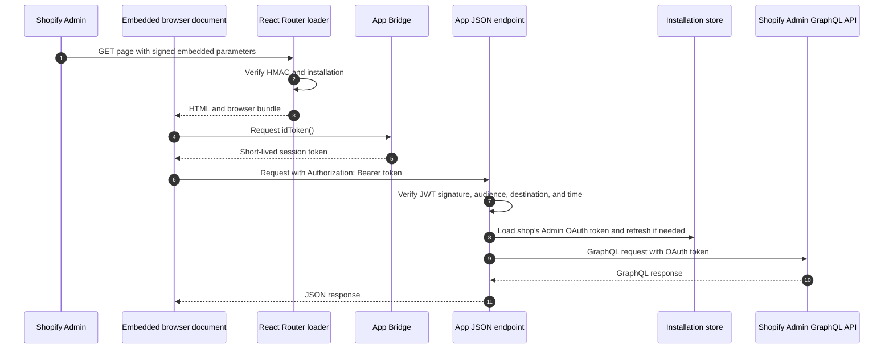
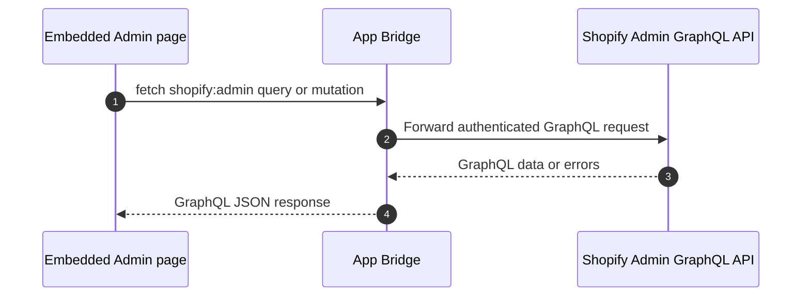
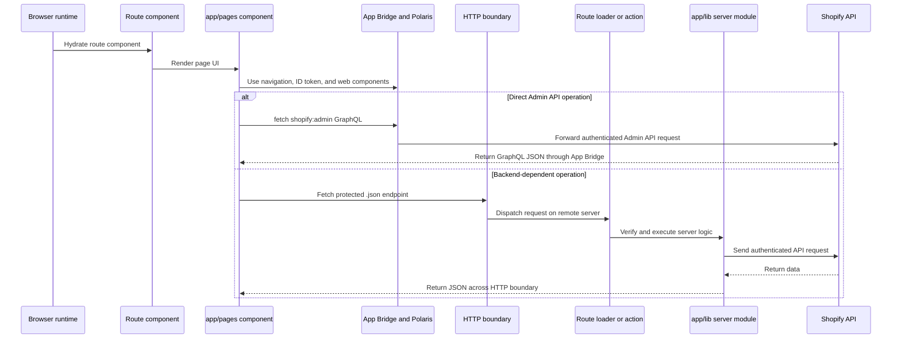
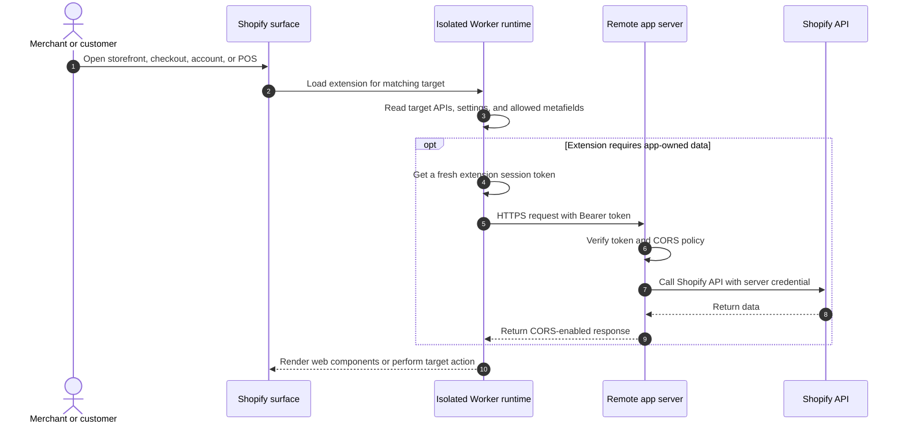
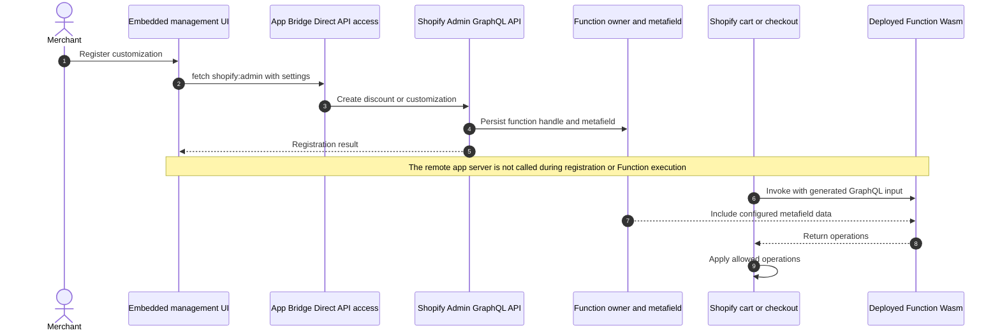

# Application Architecture

Request flows and runtime boundaries for this Node.js / React Router sample, hosted on Render. The same authentication boundaries apply to other stacks.

## Runtime Map

Use this map to find a feature's entry points; the linked guides explain each sample in detail.

| Feature | Runs in | Entry points and guides |
| --- | --- | --- |
| App Home and navigation | Merchant browser and app server | [Route map](../app/routes.js), [UI pages](../app/pages/), [app shell](../app/AppShell.jsx) |
| OAuth and token storage | App server | [OAuth](../app/lib/oauth.server.js), [token refresh](../app/lib/offline-token.server.js), [installation storage](../app/lib/shop-store.server.js) |
| Authenticated Admin API calls | Browser through App Bridge, or app server | [Direct API helper](../app/utils/direct-admin-graphql.js), [server GraphQL client](../app/lib/shopify-graphql.server.js), [session-token guide](01-sessiontoken.md) |
| Webhooks and App Proxy | App server | [Request handlers](../app/lib/public-endpoints.server.js), [webhook guide](12-eventsubscription.md), [App Proxy example](03-themeapp.md) |
| Storefront and customer login | Customer browser and app server | [Storefront guide](15-storefront.md) |
| Order and bulk operations | App server, managed from App Home | [Order management](13-ordermanage.md), [bulk operations](14-bulkoperation.md) |
| UI, theme, and analytics extensions | Shopify surfaces | [Extension samples](../extensions/), [runtime flow](#storefront-and-ui-extension-runtimes) |
| Shopify Functions | Shopify infrastructure (Wasm) | [Discount example](../extensions/my-function-discount-ext/), [runtime flow](#shopify-functions-runtime) |

Route `loader` and `action` functions run on the app server; route components and `app/pages/` render in the browser. Keep secrets and database access in `.server.js` modules.

## First Embedded Access and OAuth

The app verifies Shopify's signed entry request before trusting the shop. Missing, legacy, mismatched, or unrefreshable installations start OAuth.

Keep Admin OAuth credentials on the server. App Bridge session tokens authenticate browser-to-app requests separately.

### Offline Token Refresh Before API Use

[Token refresh](https://shopify.dev/docs/apps/build/authentication-authorization/access-tokens#token-refresh) runs on demand when five minutes or less remain; no periodic batch is needed. An expired access token can still be refreshed while its refresh token is valid.

- Serialize acquisition/refresh per shop and save the new token pair before API use.
- Reopen the app for OAuth if refresh expires or is rejected.
- Preserve credentials on temporary failures; do not automatically replay Admin mutations.

### Related Credentials: Application-only and CLI Automation Tokens

| Credential | Typical use | Key restriction |
| --- | --- | --- |
| [Expiring offline access token](https://shopify.dev/docs/apps/build/authentication-authorization/access-tokens) | Admin API calls from batches and webhook follow-up jobs | Maintain the access/refresh pair. Supports custom apps installed on customers' stores. |
| [Application-only access token](https://shopify.dev/docs/apps/build/authentication-authorization/application-only-access-tokens) | Background Admin API calls without storing refresh tokens | **For customers' production stores in another organization, public-distribution apps only.** Custom apps are limited to stores in their own organization. |
| [App CLI automation / service account token](https://shopify.dev/docs/apps/build/cli-for-apps/service-accounts) | CI/CD deployment, release, and permitted dev store management | **Cannot read or write store data through the Admin API.** |

## Non-embedded Service Connector

Set `embedded = false` to open App Home outside the Admin iframe. App Bridge is unavailable, so the server verifies Shopify's signed entry, completes OAuth, and passes a short-lived app JWT to `/mocklogin`.

The [entry route](../app/routes/auth.jsx) and [mock login handler](../app/lib/public-endpoints.server.js) simulate an external service. The app JWT is neither a Shopify session token nor an Admin API token. Use the verified shop to establish the service's own session; avoid retaining handoff tokens in URLs or logs.

**Test stores only:** This demo exposes the stored Admin token after authenticating the app JWT or Shopify session token, including on POS printouts. Remove the display in production and do not share pages, URLs, or printouts.

For non-embedded mode, change Admin Link `app://` destinations to absolute HTTPS URLs. The embedded alternative uses the Session Token page's **Connect to your service with the session token** button. See the [connector demo](../../../wiki#for-external-service-connection).

### Linking a Shopify Shop to an External Service User

1. Hand off a signed, short-lived, single-purpose token containing the verified shop. Validate signature, expiry, issuer/audience, and one-time use in the external service.
2. After external login, persist the user-to-shop association. Support multiple shops where needed and resolve later visits from that association.
3. Offer reconnect/disconnect controls and remove or disable links on uninstall.
4. Keep account linking in installation/onboarding. Follow Shopify's [sign-up guidance](https://shopify.dev/docs/apps/build/integrating-with-shopify#enable-seamless-sign-up-based-on-shopify-credentials) and [installation requirements](https://shopify.dev/docs/apps/launch/shopify-app-store/app-store-requirements#2-installation-and-setup).

A non-embedded service connector may qualify for App Store distribution, but not [Built for Shopify](https://shopify.dev/docs/apps/launch/built-for-shopify/requirements) while its primary Admin experience remains non-embedded.

## Normal Embedded Page and Server-backed API Request

Use this path for operations needing app secrets, stored data, external integrations, or server orchestration.

- Query HMAC: verifies the initial Shopify entry.
- Session JWT: authenticates browser/extension requests to the app server.
- Offline OAuth token: authorizes server-to-Admin API calls.

## Direct Admin API Request

Admin Link queries and merchant-triggered Function, Web Pixel, and post-purchase setup use [`shopify:admin`](https://shopify.dev/docs/api/app-home/apis/authentication-and-data/resource-fetching-api) through App Bridge. Enable Direct API access and the required scopes in the deployed app TOML.

No Admin token is exposed to the browser. Backend-dependent features, including OAuth, webhooks, and signing, still need server routes.

## Browser and Server Module Boundaries

Do not import secrets or server-only modules into page components. Environment variables, OAuth tokens, database access, and Admin API credentials must remain behind the HTTP boundary.

## Storefront and UI Extension Runtimes

Extensions run on their Shopify surfaces, outside the app-server process. UI extensions and app Web Pixels use isolated Worker runtimes without host DOM access; theme code runs on the storefront.

Declare required capabilities and metafields in each extension's TOML. External requests need CORS preflight support. Each placed block has isolated state; do not assume one global instance.

## Shopify Functions Runtime

The browser registers configuration through Admin API. Shopify later executes the deployed Rust/Wasm Function during cart or checkout processing.

Use the declared input and follow the Function API's Wasm/resource limits. The app database and arbitrary network access are unavailable unless explicitly supported.

## Infrastructure Independence

Other languages and hosts can use the same design: verify HMAC/JWTs, protect server credentials and installation state, preserve HTTP/CORS contracts, and deploy app configuration with its extensions.

## Official References

- [App surfaces](https://shopify.dev/docs/apps/build/app-surfaces)
- [OAuth authorization code grant](https://shopify.dev/docs/apps/build/authentication-authorization/access-tokens/authorization-code-grant)
- [Migrate to expiring offline access tokens](https://shopify.dev/docs/apps/build/authentication-authorization/migrate-to-expiring-offline-access-tokens)
- [Access token lifetimes and rotation](https://shopify.dev/docs/apps/build/authentication-authorization/access-tokens)
- [Application-only access tokens](https://shopify.dev/docs/apps/build/authentication-authorization/application-only-access-tokens)
- [Client credentials for stores in your organization](https://shopify.dev/docs/apps/build/authentication-authorization/client-credentials-grant)
- [CLI service accounts and App Automation Token migration](https://shopify.dev/docs/apps/build/cli-for-apps/service-accounts)
- [Session tokens](https://shopify.dev/docs/apps/build/authentication-authorization/session-tokens)
- [App Bridge](https://shopify.dev/docs/api/app-bridge-library)
- [App Bridge Resource Fetching API](https://shopify.dev/docs/api/app-home/apis/authentication-and-data/resource-fetching-api)
- [Using Polaris web components and the UI extension execution model](https://shopify.dev/docs/api/polaris/using-polaris-web-components)
- [Web pixel strict sandbox](https://shopify.dev/docs/apps/build/marketing-analytics/pixels)
- [Shopify Functions](https://shopify.dev/docs/api/functions/unstable)

## Demo

See the [OAuth flow demo](../../../wiki#oauth-flow).
