# Application Architecture

Request flows and runtime boundaries for this Node.js / React Router sample, hosted on Render. The same authentication boundaries apply to other stacks.

## Runtime Map

Use this map to find a feature's entry points; the linked guides explain each sample in detail.

| Feature | Runs in | Entry points and guides |
| --- | --- | --- |
| App Home and navigation | Merchant browser and app server | [Route map](../app/routes.js), [UI pages](../app/pages/), [app shell](../app/AppShell.jsx) |
| OAuth and token storage | App server | [OAuth](../app/lib/oauth.server.js), [token refresh](../app/lib/offline-token.server.js), [installation storage](../app/lib/shop-store.server.js) |
| Authenticated Admin API calls | Browser through App Bridge, or app server | [Direct API helper](../app/utils/direct-admin-graphql.js), [server GraphQL client](../app/lib/shopify-graphql.server.js), [session-token guide](01-sessiontoken.md) |
| Webhooks and App Proxy | App server | [Request handlers](../app/lib/public-endpoints.server.js), [webhook guide](12-eventsubscription.md), [App Proxy example](03-themeapp.md) |
| Storefront and customer login | Customer browser and app server | [Storefront guide](15-storefront.md) |
| Order and bulk operations | App server, managed from App Home | [Order management](13-ordermanage.md), [bulk operations](14-bulkoperation.md) |
| UI, theme, and analytics extensions | Shopify surfaces | [Extension samples](../extensions/), [runtime flow](#storefront-and-ui-extension-runtimes) |
| Shopify Functions | Shopify infrastructure (Wasm) | [Discount example](../extensions/my-function-discount-ext/), [runtime flow](#shopify-functions-runtime) |

Route `loader` and `action` functions run on the app server; route components and `app/pages/` render in the browser. Keep secrets and database access in `.server.js` modules.

## First Embedded Access and OAuth

The app verifies Shopify's signed entry request before trusting the shop. Missing, legacy, mismatched, or unrefreshable installations start OAuth.

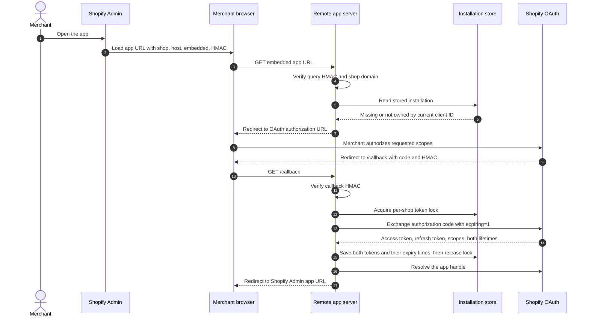

Keep Admin OAuth credentials on the server. App Bridge session tokens authenticate browser-to-app requests separately.

### Offline Token Refresh Before API Use

Each installation stores a **token pair**. The server sends the **access token** to the Admin API and uses the **refresh token** to obtain a new pair from Shopify OAuth. A valid refresh token can renew an expired access token. [Shopify's token refresh guide](https://shopify.dev/docs/apps/build/authentication-authorization/access-tokens#token-refresh)

#### On-demand refresh with a per-shop lock (this sample)

App requests and webhook handlers that need the Admin API can call the [token manager](../app/lib/offline-token.server.js) directly, without a refresh batch or queue. Both use the same per-shop lock when the access token has five minutes or less left. Receiving a webhook by itself requires no token lock.

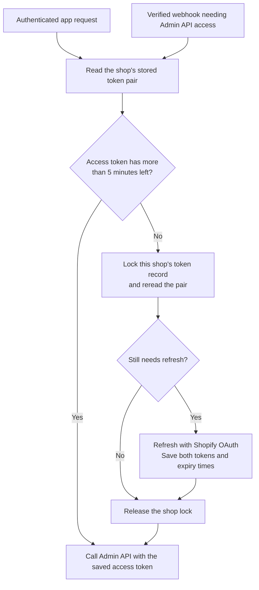

#### Scheduled refresh by a single worker (alternative)

Only the batch refreshes tokens. Schedule it ahead of expiry. For each shop, serialize refresh and OAuth acquisition from the initial read through the final save, including retries on other instances. Webhook and app request handlers can then read the saved access token without a refresh lock.

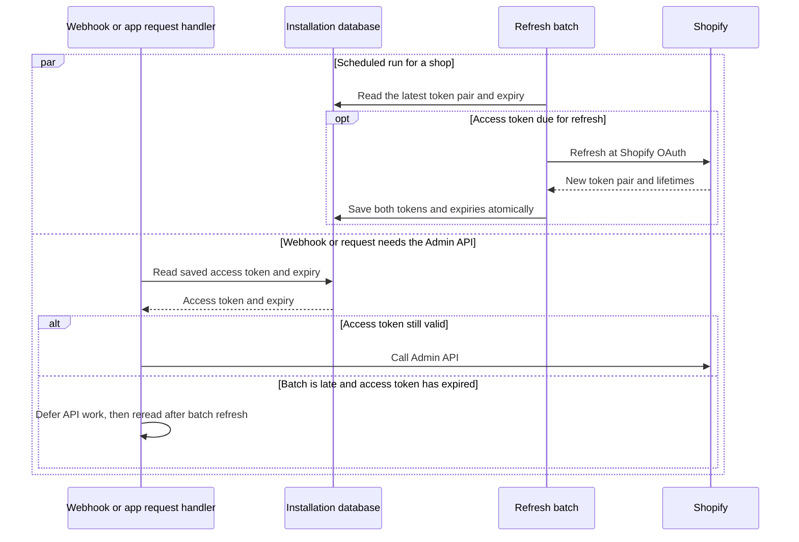

- Reopen the app for OAuth if installation credentials are missing or unusable, or if Shopify rejects the refresh token.
- Preserve credentials on temporary failures; do not automatically replay Admin mutations.

#### How the per-shop token lock works

When two workers refresh tokens for the same shop, the slower worker can save a token the other has already replaced. The next refresh may then fail and require the merchant to reauthorize. See [Shopify's guidance on concurrent refreshes](https://shopify.dev/docs/apps/build/authentication-authorization/implement-token-exchange?lang=node#send-the-refresh-request).

In this sample, OAuth acquisition and refresh share one database lock per shop across server processes. A batch that shares refresh duties with request handlers must use the same lock. Other shops can refresh in parallel. See the [lock implementation](../app/lib/shop-store.server.js).

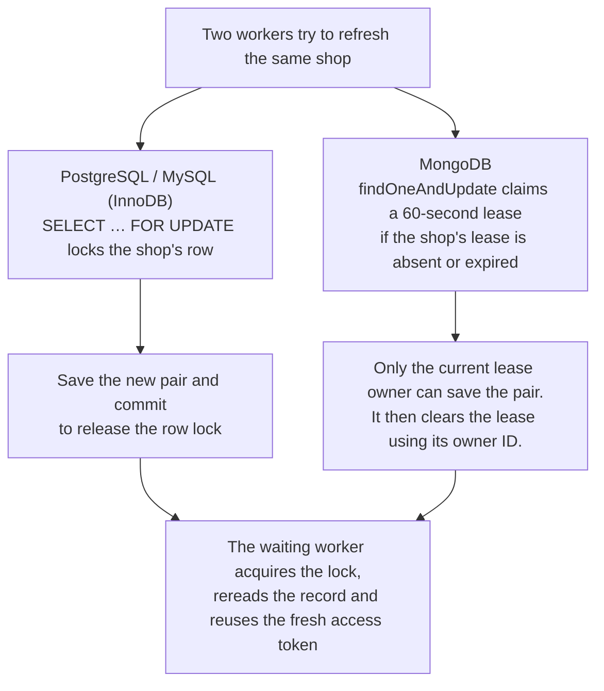

#### Offline token refresh FAQ

**Does the merchant have to sign in every 90 days?**

Each successful refresh issues a new pair without a sign-in. The access token currently lasts one hour, and the new refresh token expires 90 days after that refresh. Use the returned `expires_in` and `refresh_token_expires_in` values. An app relying on this pair needs the merchant to reconnect if the refresh token expires. [Token lifetimes](https://shopify.dev/docs/apps/build/authentication-authorization/access-tokens#token-lifetimes) · [Refresh token rotation](https://shopify.dev/docs/apps/build/authentication-authorization/access-tokens#how-refresh-token-rotation-works)

**How should a merchant backend integration authenticate to Shopify?**

After installation and scope approval, a custom app can export orders to the merchant's backend system (such as an ERP or another core business system) and process incoming inventory webhooks without a signed-in user.

- **Partner-owned app, client-owned store (custom distribution).** Obtain an expiring offline token at installation and refresh it on the server. [Standalone or API-only app authentication](https://shopify.dev/docs/apps/build/authentication-authorization/authenticate-standalone-apps?lang=node) · [Non-embedded Service Connector](#non-embedded-service-connector)
- **App and store in the merchant's Shopify organization.** The server can also use its client ID and secret to request a fresh token after months of inactivity, without a stored refresh token or a merchant session. [Client credentials grant](https://shopify.dev/docs/apps/build/authentication-authorization/client-credentials-grant?lang=node) · [Compare with the application-only access token below](#four-token-types-compared)

*Unattended custom app flows*

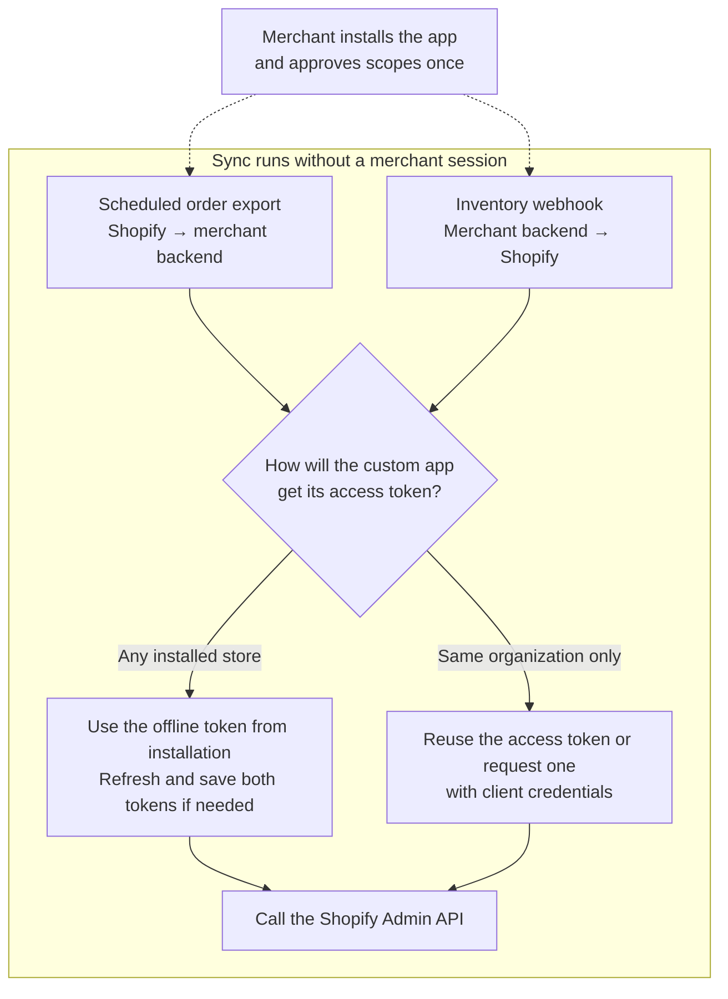

**Is an expiring offline token enough for background GraphQL Admin API calls?**

Yes. With the same approved scopes, an expiring offline token can make the same calls as a token issued through the client credentials grant, whether the app uses its client secret or a signed JWT (application-only access). [Shopify app authentication](https://shopify.dev/docs/apps/build/authentication-authorization#how-it-works)

If an inventory webhook arrives after months of inactivity and the refresh token has expired or been lost, the merchant must reconnect to resume offline refresh. For an eligible store where the app is still installed, client credentials let the server obtain a fresh token without a merchant session. [Shopify's token recovery guidance](https://shopify.dev/docs/apps/build/authentication-authorization/implement-token-exchange?lang=node#send-the-refresh-request) · [Eligibility by credential](#four-token-types-compared)

**Should we refresh offline tokens hourly, daily, or when work arrives?**

With on-demand refresh, check expiry when the nightly sync starts or the webhook needs the API. With a dedicated refresh batch, allow for scheduling delays when choosing how early to renew. If events may stop for months, a daily scan can refresh just the shops whose **refresh tokens** are nearing expiry. [Shopify's guidance for background jobs and idle stores](https://shopify.dev/docs/apps/build/authentication-authorization/access-tokens#token-refresh)

**Can one batch or webhook worker handle all refreshes without a separate DB lock?**

Yes, if only one operation per app and shop can acquire or refresh tokens at a time, from reading the credentials through saving the new pair. This must hold across OAuth callbacks, retries, and all worker instances. Keep the shared lock if any of those paths can overlap. The previous access token remains usable until expiry. [Token acquisition and refresh](https://shopify.dev/docs/apps/build/authentication-authorization/access-tokens#token-refresh) · [Concurrent refreshes and token validity](https://shopify.dev/docs/apps/build/authentication-authorization/implement-token-exchange?lang=node#send-the-refresh-request)

**Should webhook-driven Admin API calls go through a queue?**

Save the event to a queue before acknowledging delivery. One active job per app and shop is a simple way to smooth bursts while other shops run in parallel. Even serial calls can exhaust the GraphQL query-cost budget. Use `extensions.cost.throttleStatus` to pace requests and back off when throttled. [Queueing webhook deliveries](https://shopify.dev/docs/apps/build/webhooks/verify-deliveries#queue-webhooks-to-handle-traffic-bursts) · [GraphQL Admin API rate limits](https://shopify.dev/docs/apps/build/apis/graphql-admin/rate-limits#graphql-response)

### Four Token Types Compared

| Credential | How it works | Use and limits | Example use case |
| --- | --- | --- | --- |
| [Expiring offline access token](https://shopify.dev/docs/apps/build/authentication-authorization/access-tokens#token-refresh) | Store and refresh the pair issued after merchant authorization. The merchant reconnects if the refresh token expires or is lost. | Admin API calls with the app's approved scopes, including on client stores. Use an [online token](https://shopify.dev/docs/apps/build/authentication-authorization/access-tokens#online-access-tokens) for staff-specific permissions. | Merchant-triggered app operations, scheduled batches, and webhook jobs. |
| [Client credentials with a client secret](https://shopify.dev/docs/apps/build/authentication-authorization/client-credentials-grant?lang=node) | Request a token on demand with `grant_type=client_credentials`, the client ID, and the client secret. No refresh token. | Installed stores in the app's own organization only (24 hours). | Resume unattended jobs on the merchant's own stores without a usable refresh token. |
| [Application-only access token](https://shopify.dev/docs/apps/build/authentication-authorization/application-only-access-tokens) | Same grant, using a JWT signed with the app's private key (`client_assertion`). Request a fresh token on demand without a refresh token. | **Public distribution** covers any installed store (up to 1 hour). **Custom apps** cover only stores in their own organization (24 hours). | Resume a public app's jobs on client stores without a refresh token or merchant sign-in. |
| [App CLI automation / service account token](https://shopify.dev/docs/apps/build/cli-for-apps/service-accounts) | CI/CD deployment, release, and permitted dev store management | **Cannot read or write store data through the Admin API.** | Deploy an app from CI/CD with `shopify app deploy`. |

## Non-embedded Service Connector

With `embedded = false`, App Home opens outside the Admin iframe without App Bridge. The app issues a short-lived JWT for the handoff to `/mocklogin`. Both the installation check and `/mocklogin` obtain the shop's Admin access token through the [same refresh flow as the embedded app](#offline-token-refresh-before-api-use).

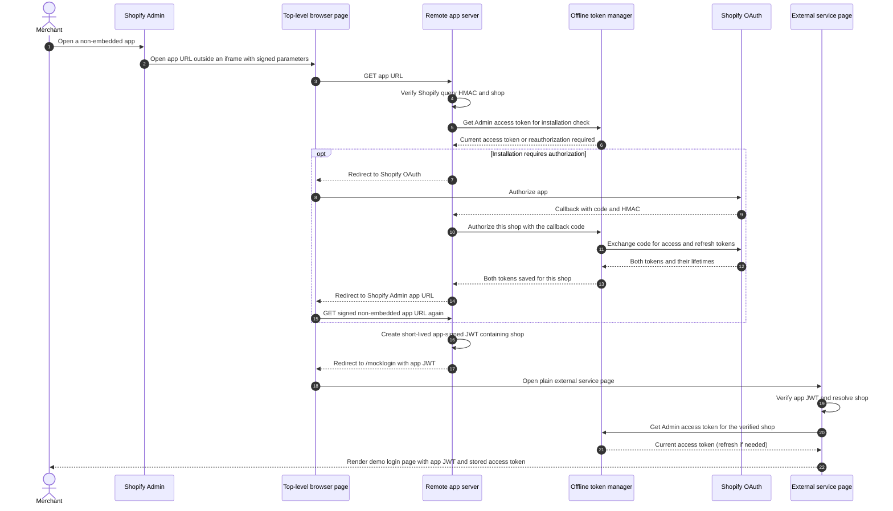

The [entry route](../app/routes/auth.jsx) and [mock login handler](../app/lib/public-endpoints.server.js) simulate an external service. The app JWT is neither a Shopify session token nor an Admin API token. Use the verified shop to establish the service's own session; avoid retaining handoff tokens in URLs or logs.

**Test stores only:** This demo exposes the stored Admin token after authenticating the app JWT or Shopify session token, including on POS printouts. Remove the display in production and do not share pages, URLs, or printouts.

For non-embedded mode, change Admin Link `app://` destinations to absolute HTTPS URLs. The embedded alternative uses the Session Token page's **Connect to your service with the session token** button. See the [connector demo](../../../wiki#for-external-service-connection).

### Linking a Shopify Shop to an External Service User

1. Hand off a signed, short-lived, single-purpose token containing the verified shop. Validate signature, expiry, issuer/audience, and one-time use in the external service.
2. After external login, persist the user-to-shop association. Support multiple shops where needed and resolve later visits from that association.
3. Offer reconnect/disconnect controls and remove or disable links on uninstall.
4. Keep account linking in installation/onboarding. Follow Shopify's [sign-up guidance](https://shopify.dev/docs/apps/build/integrating-with-shopify#enable-seamless-sign-up-based-on-shopify-credentials) and [installation requirements](https://shopify.dev/docs/apps/launch/shopify-app-store/app-store-requirements#2-installation-and-setup).

A non-embedded service connector may qualify for App Store distribution, but not [Built for Shopify](https://shopify.dev/docs/apps/launch/built-for-shopify/requirements) while its primary Admin experience remains non-embedded.

## Normal Embedded Page and Server-backed API Request

Use this path for operations needing app secrets, stored data, external integrations, or server orchestration.

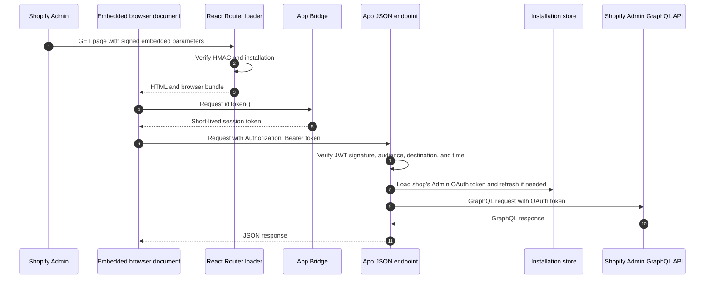

- Query HMAC: verifies the initial Shopify entry.
- Session JWT: authenticates browser/extension requests to the app server.
- Offline OAuth token: authorizes server-to-Admin API calls.

## Direct Admin API Request

Admin Link queries and merchant-triggered Function, Web Pixel, and post-purchase setup use [`shopify:admin`](https://shopify.dev/docs/api/app-home/apis/authentication-and-data/resource-fetching-api) through App Bridge. Enable Direct API access and the required scopes in the deployed app TOML.

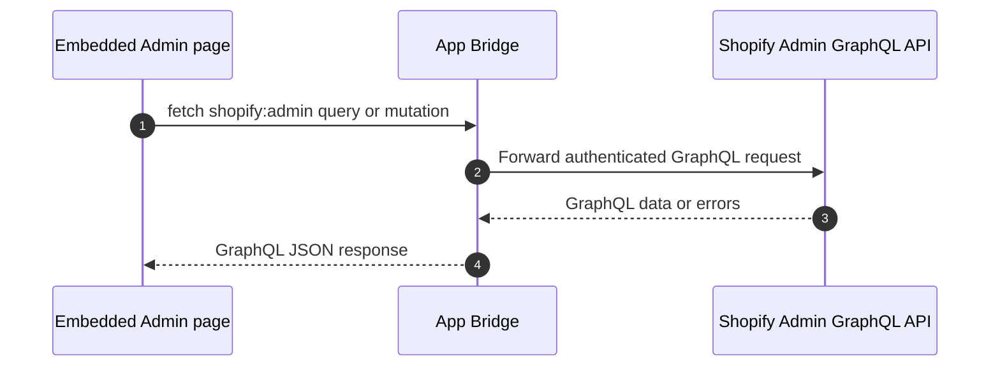

No Admin token is exposed to the browser. Backend-dependent features, including OAuth, webhooks, and signing, still need server routes.

## Browser and Server Module Boundaries

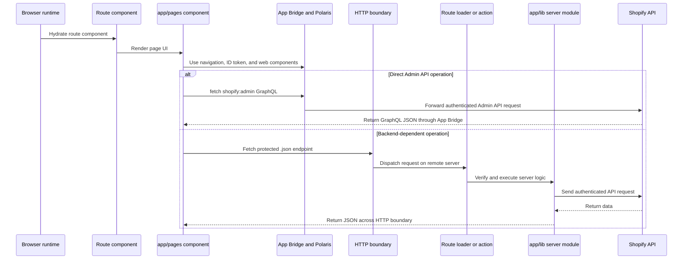

Do not import secrets or server-only modules into page components. Environment variables, OAuth tokens, database access, and Admin API credentials must remain behind the HTTP boundary.

## Storefront and UI Extension Runtimes

Extensions run on their Shopify surfaces, outside the app-server process. UI extensions and app Web Pixels use isolated Worker runtimes without host DOM access; theme code runs on the storefront.

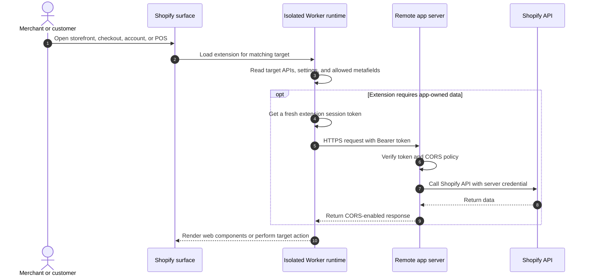

Declare required capabilities and metafields in each extension's TOML. External requests need CORS preflight support. Each placed block has isolated state; do not assume one global instance.

## Shopify Functions Runtime

The browser registers configuration through Admin API. Shopify later executes the deployed Rust/Wasm Function during cart or checkout processing.

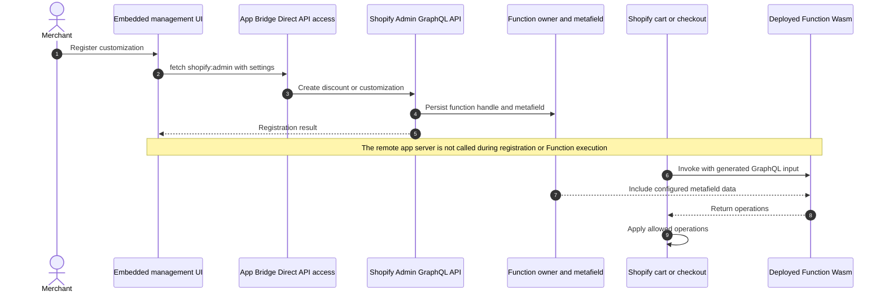

Use the declared input and follow the Function API's Wasm/resource limits. The app database and arbitrary network access are unavailable unless explicitly supported.

## Infrastructure Independence

Other languages and hosts can use the same design: verify HMAC/JWTs, protect server credentials and installation state, preserve HTTP/CORS contracts, and deploy app configuration with its extensions.

## Official References

- [App surfaces](https://shopify.dev/docs/apps/build/app-surfaces)
- [OAuth authorization code grant](https://shopify.dev/docs/apps/build/authentication-authorization/access-tokens/authorization-code-grant)
- [Migrate to expiring offline access tokens](https://shopify.dev/docs/apps/build/authentication-authorization/migrate-to-expiring-offline-access-tokens)
- [Access token lifetimes and rotation](https://shopify.dev/docs/apps/build/authentication-authorization/access-tokens)
- [Application-only access tokens](https://shopify.dev/docs/apps/build/authentication-authorization/application-only-access-tokens)
- [Client credentials for stores in your organization](https://shopify.dev/docs/apps/build/authentication-authorization/client-credentials-grant)
- [CLI service accounts and App Automation Token migration](https://shopify.dev/docs/apps/build/cli-for-apps/service-accounts)
- [Session tokens](https://shopify.dev/docs/apps/build/authentication-authorization/session-tokens)
- [App Bridge](https://shopify.dev/docs/api/app-bridge-library)
- [App Bridge Resource Fetching API](https://shopify.dev/docs/api/app-home/apis/authentication-and-data/resource-fetching-api)
- [Using Polaris web components and the UI extension execution model](https://shopify.dev/docs/api/polaris/using-polaris-web-components)
- [Web pixel strict sandbox](https://shopify.dev/docs/apps/build/marketing-analytics/pixels)
- [Shopify Functions](https://shopify.dev/docs/api/functions/unstable)

## Demo

See the [OAuth flow demo](../../../wiki#oauth-flow).
