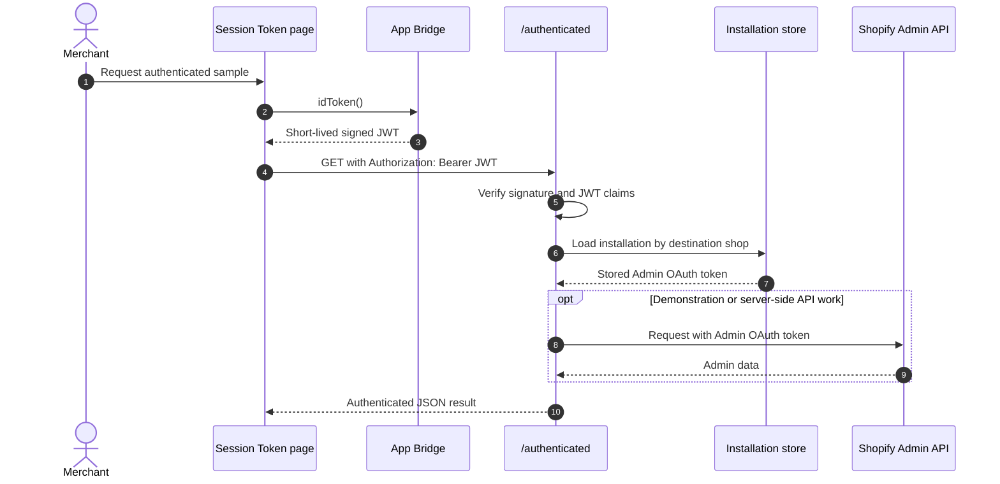

# Session Token

## Purpose

The `/sessiontoken` sample authenticates browser-to-app requests with an App Bridge session token. Server-to-Admin API calls use a separate offline OAuth token; see the [architecture guide](00-ARCHITECTURE.md).

## Request Sequence

## How It Works

`authenticatedFetch()` gets a fresh token from [`shopify.idToken()`](https://shopify.dev/docs/api/app-bridge-library/apis/id-token) and sends it as a Bearer token. The server verifies it before loading the shop's installation and [refreshing offline credentials](00-ARCHITECTURE.md#offline-token-refresh-before-api-use).

The `/mocklogin` demo accepts a Shopify session token or the [non-embedded connector's app JWT](00-ARCHITECTURE.md#non-embedded-service-connector).

> **Test stores only:** `/mocklogin` and POS printouts expose the stored Admin token after authentication. Remove that display in production; do not share the page, URL, or printout.

## Common Pitfalls

- Session tokens authenticate app-server requests; they cannot call Admin GraphQL.
- Get a fresh session token before each request.
- Verify JWT signature, audience, destination, and time claims. Derive the shop from the verified token.
- Reauthorize when the app client changes or offline refresh is no longer possible.
- URL tokens can leak through browser history and logs; avoid reusable credentials in URLs.

## Source Map

- [Demo UI](../app/pages/SessionToken.jsx)
- [Browser token and fetch helpers](../app/utils/app-bridge.js)
- [Server verification](../app/lib/session-token.server.js)
- [Service connector handler](../app/lib/public-endpoints.server.js)

## Official Shopify References

- [Session tokens](https://shopify.dev/docs/apps/build/authentication-authorization/session-tokens)
- [Authenticate requests from Shopify embedded apps](https://shopify.dev/docs/apps/build/authentication-authorization/session-tokens/set-up-session-tokens)
- [OAuth authorization code grant](https://shopify.dev/docs/apps/build/authentication-authorization/access-tokens/authorization-code-grant)
- [App Bridge ID token API](https://shopify.dev/docs/api/app-bridge-library/apis/id-token)

## Demo

See the [Session Token (ID Token) demo](../../../wiki#session-token-id-token).
