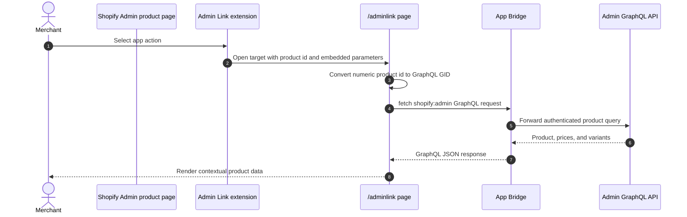

# Admin Link

## Purpose

The `/adminlink` sample opens this app from product and order actions in Shopify Admin. The product page loads data through App Bridge Direct API access.

## Request Sequence

## How It Works

The product action points to `app://adminlink`; the order action opens order management. Shopify adds the selected resource ID to the destination URL.

Enable `[access.admin].embedded_app_direct_api_access = true` in the deployed app TOML. This sample uses `direct_api_mode = "offline"`; omitting the mode defaults to online authorization.

## Common Pitfalls

- Non-embedded apps require an absolute HTTPS link instead of `app://`.
- Direct API access requires App Bridge and the configured scopes; keep Admin tokens out of the page.
- Convert numeric IDs to GraphQL GIDs and specify the intended API version.
- An unsigned direct visit returns HTTP 400 (`HMAC verification failed`).
- Direct API requests appear in the browser's `[shopify-admin-direct]` logs, not the app-server logs.

## Source Map

- [Product action](../extensions/my-admin-link-product-details/shopify.extension.toml) and [order action](../extensions/my-admin-link-order-details/shopify.extension.toml)
- [Demo UI](../app/pages/AdminLink.jsx)
- [Direct API helper](../app/utils/direct-admin-graphql.js)

## Official Shopify References

- [Admin UI extensions](https://shopify.dev/docs/api/admin-extensions/unstable)
- [Admin extension targets](https://shopify.dev/docs/api/admin-extensions/unstable/extension-targets)
- [App Bridge Resource Fetching API](https://shopify.dev/docs/api/app-home/apis/authentication-and-data/resource-fetching-api)
- [App configuration](https://shopify.dev/docs/apps/build/cli-for-apps/app-configuration)
- [GraphQL global IDs](https://shopify.dev/docs/api/usage/gids)
- [Admin GraphQL API](https://shopify.dev/docs/api/admin-graphql/unstable)
