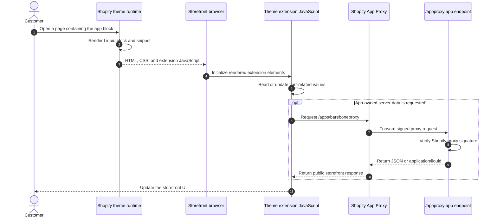
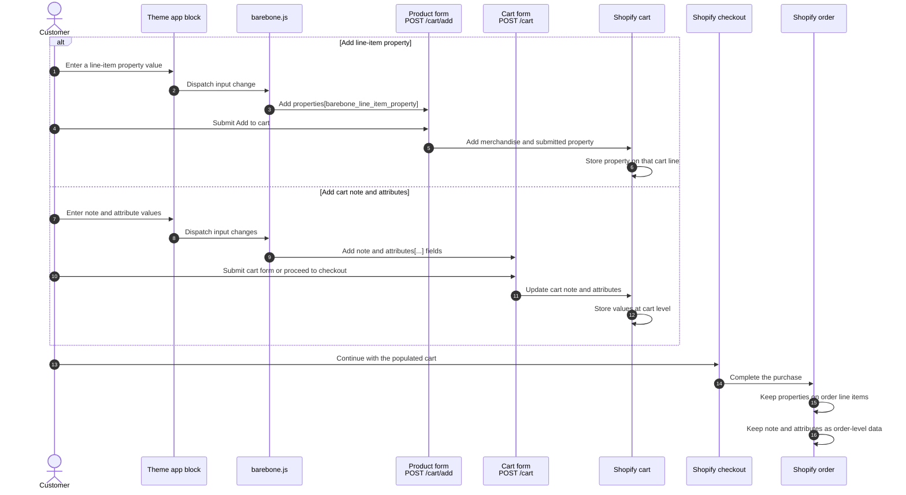

# Theme App Extension

## Purpose

The `/themeapp` sample demonstrates theme blocks and embeds, cart data, custom pixel events, and signed App Proxy requests.

## Storefront Sequence

## Cart Data Persistence Sequence

Hidden inputs on standard product and cart forms carry properties, attributes, and notes through checkout to the order.

## How It Works

Merchants add blocks or enable embeds in the theme editor. App Proxy requests use a shop-domain URL; the app server verifies Shopify's signature before returning customer-visible data.

## Common Pitfalls

- Deploying does not place a block or enable an embed; use the theme editor.
- App Proxy signatures use a different verification algorithm from webhook HMACs.
- App Proxy responses are public. Never return Admin tokens or private merchant data.
- Theme initialization can repeat; make it safe to run more than once.
- Line-item properties belong to individual lines; cart attributes and notes belong to the cart.

## Source Map

- [Theme blocks and embeds](../extensions/my-theme-app-ext/blocks/)
- [Storefront JavaScript](../extensions/my-theme-app-ext/assets/barebone.js)
- [App Proxy handler](../app/lib/public-endpoints.server.js)

## Official Shopify References

- [Theme app extensions](https://shopify.dev/docs/apps/build/online-store/theme-app-extensions)
- [App blocks for themes](https://shopify.dev/docs/apps/build/online-store/theme-app-extensions/configuration#app-blocks-for-themes)
- [App embed blocks](https://shopify.dev/docs/apps/build/online-store/theme-app-extensions/configuration#app-embed-blocks)
- [App proxies](https://shopify.dev/docs/apps/build/online-store/app-proxies)
- [Line item properties](https://shopify.dev/docs/storefronts/themes/architecture/templates/product/overview#line-item-properties)
- [Cart notes and attributes](https://shopify.dev/docs/storefronts/themes/architecture/templates/cart#support-cart-notes-and-attributes)
