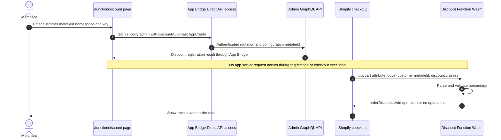

# Function Discount

## Purpose

The `/functiondiscount` sample applies a percentage order discount from a customer metafield or cart attribute.

## Registration and Execution

## How It Works

The merchant selects a customer metafield namespace and key. A cart attribute takes precedence when present; only percentages greater than zero and at most 100 produce a discount.

Registration uses [App Bridge Direct API access](00-ARCHITECTURE.md#direct-admin-api-request); checkout executes the deployed Wasm on Shopify, without calling the app server.

## Common Pitfalls

- Registration requires an embedded app, deployed Direct API configuration, and the required Admin scopes.
- Customer metafields require a matching logged-in customer and the correct namespace/key in the Function input.
- Missing or invalid percentages produce no discount; discount classes and combination rules still apply.
- **Cart attributes are buyer-controlled.** Do not trust them as discount authority in production.

## Source Map

- [Registration UI](../app/pages/FunctionDiscount.jsx)
- [Function input](../extensions/my-function-discount-ext/src/cart_lines_discounts_generate_run.graphql)
- [Rust logic and tests](../extensions/my-function-discount-ext/src/cart_lines_discounts_generate_run.rs)

## Official Shopify References

- [Discount Function API](https://shopify.dev/docs/api/functions/unstable/discount)
- [Create an automatic app discount](https://shopify.dev/docs/api/admin-graphql/unstable/mutations/discountAutomaticAppCreate)
- [App Bridge Resource Fetching API](https://shopify.dev/docs/api/app-home/apis/authentication-and-data/resource-fetching-api)
- [Shopify Functions](https://shopify.dev/docs/api/functions/unstable)
- [Metafields](https://shopify.dev/docs/apps/build/custom-data/metafields)
