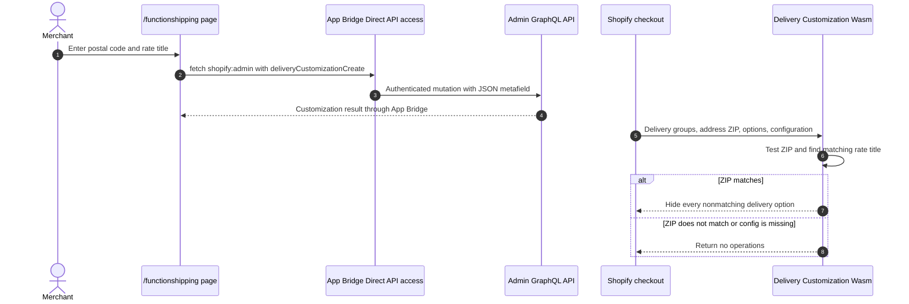

# Function Shipping

## Purpose

The `/functionshipping` sample keeps one delivery-rate title and hides other options when the destination matches a configured postal code.

## Registration and Execution

## How It Works

The registration form stores the postal code and rate title. If any delivery group matches, the Function hides options with other titles. It does not create shipping rates.

Registration uses [App Bridge Direct API access](00-ARCHITECTURE.md#direct-admin-api-request); checkout executes the deployed Wasm on Shopify, without calling the app server.

## Common Pitfalls

- Registration requires an embedded app, deployed Direct API configuration, and the required Admin scopes.
- Match Shopify's runtime rate title exactly and define postal-code normalization for each market.
- Ensure the rate you want to keep exists; test destinations with multiple delivery groups.
- Checkout can rerun the Function whenever relevant inputs change.

## Source Map

- [Registration UI](../app/pages/FunctionShipping.jsx)
- [Function input](../extensions/my-function-shipping-ext/src/cart_delivery_options_transform_run.graphql)
- [Rust logic and tests](../extensions/my-function-shipping-ext/src/cart_delivery_options_transform_run.rs)

## Official Shopify References

- [Delivery Customization Function API](https://shopify.dev/docs/api/functions/unstable/delivery-customization)
- [Create a delivery customization](https://shopify.dev/docs/api/admin-graphql/unstable/mutations/deliveryCustomizationCreate)
- [App Bridge Resource Fetching API](https://shopify.dev/docs/api/app-home/apis/authentication-and-data/resource-fetching-api)
- [Shopify Functions](https://shopify.dev/docs/api/functions/unstable)
