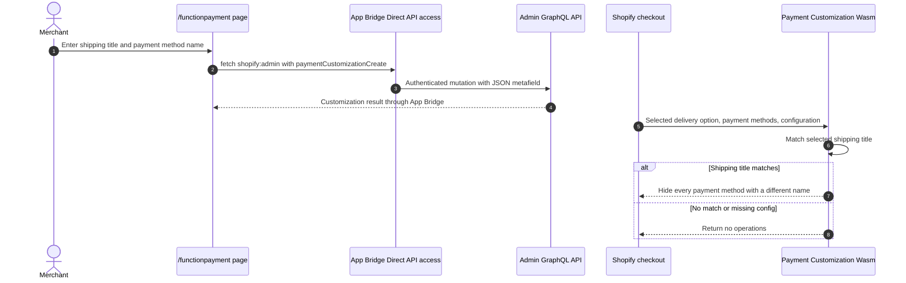

# Function Payment

## Purpose

The `/functionpayment` sample keeps one payment method and hides others when the selected shipping title matches its settings.

## Registration and Execution

## How It Works

The Function matches the shipping title and payment name, then hides nonmatching payment method IDs. It filters existing methods; it cannot activate a gateway.

Registration uses [App Bridge Direct API access](00-ARCHITECTURE.md#direct-admin-api-request); checkout executes the deployed Wasm on Shopify, without calling the app server.

## Common Pitfalls

- Registration requires an embedded app, deployed Direct API configuration, and the required Admin scopes.
- Match runtime names exactly and use the current payment IDs, not list positions or IDs from earlier logs.
- **If the configured method is absent, this sample can hide every method.** Add a production fallback.

## Source Map

- [Registration UI](../app/pages/FunctionPayment.jsx)
- [Function input](../extensions/my-function-payment-ext/src/cart_payment_methods_transform_run.graphql)
- [Rust logic and tests](../extensions/my-function-payment-ext/src/cart_payment_methods_transform_run.rs)

## Official Shopify References

- [Payment Customization Function API](https://shopify.dev/docs/api/functions/unstable/payment-customization)
- [Create a payment customization](https://shopify.dev/docs/api/admin-graphql/unstable/mutations/paymentCustomizationCreate)
- [App Bridge Resource Fetching API](https://shopify.dev/docs/api/app-home/apis/authentication-and-data/resource-fetching-api)
- [Shopify Functions](https://shopify.dev/docs/api/functions/unstable)
