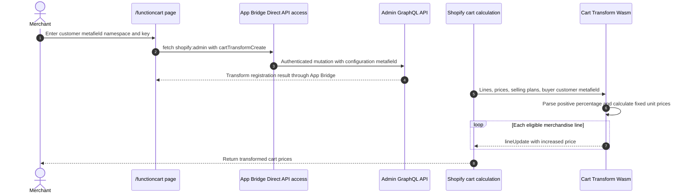

# Function Cart

## Purpose

The `/functioncart` sample increases eligible cart-line prices using a percentage from the logged-in customer's metafield. Use the [Discount Function](04-functiondiscount.md) sample for reductions.

## Registration and Execution

## How It Works

For a valid positive percentage, the Function returns `price × (1 + percentage / 100)` as the fixed unit price. Selling-plan lines are skipped.

Registration uses [App Bridge Direct API access](00-ARCHITECTURE.md#direct-admin-api-request); checkout executes the deployed Wasm on Shopify, without calling the app server.

## Common Pitfalls

- Registration requires an embedded app, deployed Direct API configuration, and the required Admin scopes.
- Check merchant eligibility and Cart Transform restrictions before adopting this pricing pattern.
- The customer must be logged in with a valid value at the configured metafield namespace/key.
- Define currency rounding rules and retain the selling-plan exclusion.
- Use the Discount Function API for reductions.

## Source Map

- [Registration UI](../app/pages/FunctionCart.jsx)
- [Function input](../extensions/my-function-cart-ext/src/cart_transform_run.graphql)
- [Rust logic and tests](../extensions/my-function-cart-ext/src/cart_transform_run.rs)

## Official Shopify References

- [Cart Transform Function API](https://shopify.dev/docs/api/functions/unstable/cart-transform)
- [Create a cart transform](https://shopify.dev/docs/api/admin-graphql/unstable/mutations/cartTransformCreate)
- [App Bridge Resource Fetching API](https://shopify.dev/docs/api/app-home/apis/authentication-and-data/resource-fetching-api)
- [Shopify Functions](https://shopify.dev/docs/api/functions/unstable)
