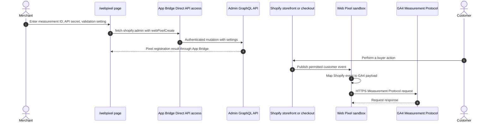

# Web Pixel

## Purpose

The `/webpixel` sample registers an app Web Pixel and sends selected customer events to Google Analytics 4 through Measurement Protocol.

## Registration and Event Sequence

## How It Works

App Bridge Direct API access registers the pixel settings. The deployed extension maps Shopify customer events to GA4 payloads and sends them directly to Google.

## Common Pitfalls

- Registration requires embedded Direct API access and Admin scopes; success does not prove GA4 accepted events.
- The pixel runs in a strict Worker sandbox without storefront DOM access.
- Consent and regional privacy rules affect event availability and data.
- Pixel settings, including the GA4 API secret, are visible to the runtime. The sample redacts settings from Direct API logs.
- Check the isolated extension console, request payloads, and GA4 DebugView or Realtime reports.

## Source Map

- [Registration UI](../app/pages/WebPixel.jsx)
- [Event subscriptions](../extensions/my-web-pixel-ext/src/index.js) and [GA4 mapping](../extensions/my-web-pixel-ext/src/ga4.js)
- [Settings and privacy configuration](../extensions/my-web-pixel-ext/shopify.extension.toml)

## Official Shopify References

- [Web Pixels API](https://shopify.dev/docs/api/web-pixels-api)
- [Create a custom pixel](https://shopify.dev/docs/apps/build/marketing-analytics/pixels)
- [App Bridge Resource Fetching API](https://shopify.dev/docs/api/app-home/apis/authentication-and-data/resource-fetching-api)
- [Customer events reference](https://shopify.dev/docs/api/web-pixels-api/standard-events)
- [Web pixel privacy settings](https://shopify.dev/docs/apps/build/marketing-analytics/pixels#requesting-consent)
