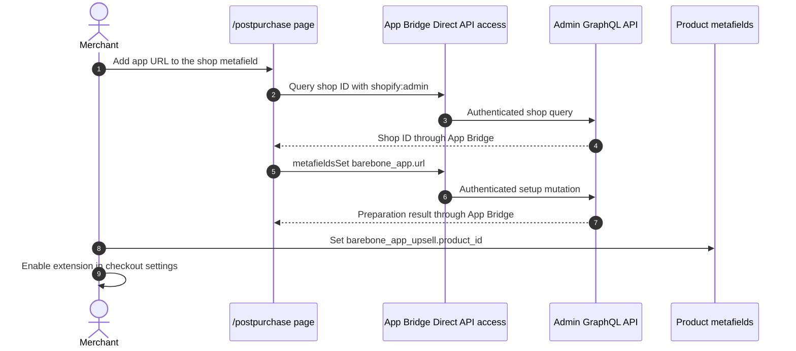
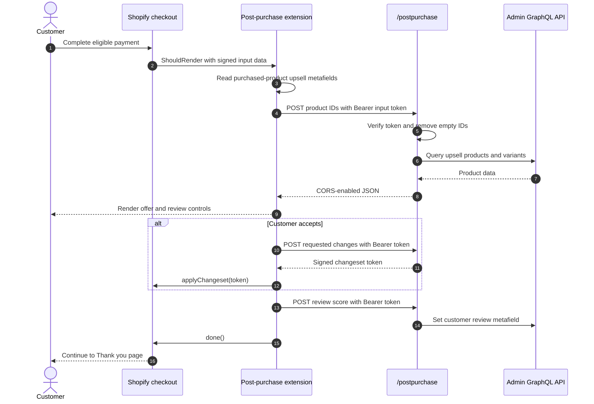

# Post-purchase

## Purpose

The `/postpurchase` sample offers products after payment, applies accepted changes through a signed changeset, and records a review score.

## Preparation Sequence

## Buyer Sequence

## How It Works

`ShouldRender` loads products referenced by `barebone_app_upsell.product_id`; `Render` displays the stored offers. The server verifies the input token, signs accepted changes, and updates the review metafield.

Only merchant setup uses Direct API access. Buyer-facing operations need the app server for token verification and signing.

## Common Pitfalls

- Payment and checkout restrictions can prevent the offer from appearing; see the official limitations below.
- Skip missing product metafields and avoid rendering an empty offer page.
- Verify the Bearer input token before trusting shop, purchase, or customer identity. Keep changeset signing on the server.
- Handle `OPTIONS` preflight and actual-response CORS headers consistently.
- Call `done()` on both acceptance and rejection paths.
- Merchant setup requires embedded Direct API access and Admin scopes.

## Source Map

- [Setup UI](../app/pages/PostPurchase.jsx)
- [Offer extension](../extensions/my-post-purchase-ext/src/index.jsx)
- [Server lookup and signing](../app/lib/post-purchase.server.js)
- [CORS preflight handling](../server.mjs)

## Official Shopify References

- [Post-purchase extensions](https://shopify.dev/docs/apps/build/checkout/product-offers)
- [App Bridge Resource Fetching API](https://shopify.dev/docs/api/app-home/apis/authentication-and-data/resource-fetching-api)
- [Post-purchase extension points](https://shopify.dev/docs/api/checkout-extensions/extension-points)
- [Post-purchase JWT specification](https://shopify.dev/docs/api/checkout-extensions/post-purchase/jwt-specification)
- [Post-purchase limitations and considerations](https://shopify.dev/docs/apps/checkout/post-purchase#limitations-and-considerations)
- [Checkout network access](https://shopify.dev/docs/apps/build/checkout/capabilities#network-access)
