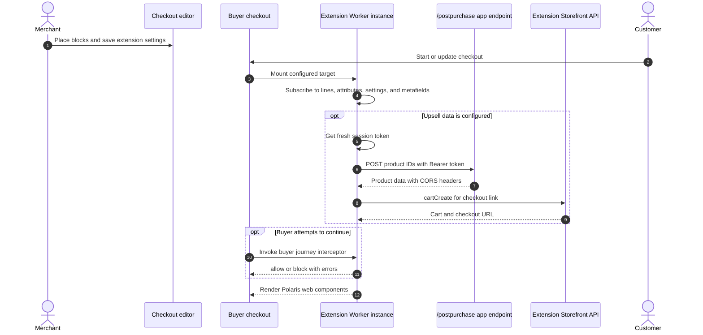
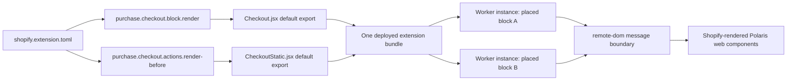

# Checkout UI

## Purpose

The `/checkoutui` samples cover upsells, cart updates, validation, address suggestions, and reactive checkout data with Preact and Polaris web components.

## Checkout Sequence

## Included Extension Packages

| Package | Focus |
| --- | --- |
| [my-checkout-ui-ext](../extensions/my-checkout-ui-ext/) | Upsells, reviews, validation, addresses, and API calls |
| [my-checkout-ui-ext-2](../extensions/my-checkout-ui-ext-2/) | Reactive data at dynamic/static targets; Preact and vanilla JS examples |
| [my-checkout-ui-ext-3](../extensions/my-checkout-ui-ext-3/) | Invisible `block_progress` block for mobile summary behavior |

## Target, Module, and Worker Relationship

One target maps to one default module entry point. Reuse code through imports; separate placements still create independent runtime instances.

## Differences from the Wiki Deep Dive

The [Wiki deep dive](../../../wiki/Checkout-UI-Extension-Integration-Deep-Dive) explains reactive execution and Worker isolation using older names. Current code uses Preact, Polaris `s-` components, `shopify` signals, and one default entry point per target. Use the extension Storage API rather than assuming browser `localStorage` behavior.

## How It Works

Upsell and review modules read the metafields declared in TOML and call `/postpurchase` with an extension session token. An upsell can update the active checkout or create a separate Storefront cart.

Validation uses configured IP, message, and quantity conditions. Address suggestions use a dedicated target; network, Storefront API, metafield, and blocking capabilities must be configured separately.

## Reactive and Asynchronous Behavior

- Wait for required signals; early values can be empty and later updates can rerun effects.
- Compare current and desired values before writing. Reading and unconditionally writing the same value creates feedback loops.
- Keep components synchronous. Use async handlers/effects, await dependent writes, and check results.
- Each placed block has isolated state. Shared imports do not create a shared Worker or global guard.

## Common Pitfalls

- Deploy, then place blocks in the checkout editor. Availability depends on plan and target.
- `buyerJourney.intercept` takes a callback; return `{behavior: 'allow'}` or `{behavior: 'block'}` and derive messages from the same state.
- External fetch needs network access, CORS, and server-side session-token verification.
- Storefront API access is separate from Admin API credentials.
- Render with Shopify web components; the extension cannot directly control the checkout DOM.

## Source Map

- [Targets, capabilities, and metafields](../extensions/my-checkout-ui-ext/shopify.extension.toml)
- [Upsell](../extensions/my-checkout-ui-ext/src/Upsell.jsx), [validation](../extensions/my-checkout-ui-ext/src/Validation.jsx), and [address suggestions](../extensions/my-checkout-ui-ext/src/Address.jsx)
- [Reactive Preact sample](../extensions/my-checkout-ui-ext-2/src/Checkout.jsx) and [vanilla JS comparison](../extensions/my-checkout-ui-ext-2/src/Checkout.js)

## Official Shopify References

- [Checkout UI extensions](https://shopify.dev/docs/api/checkout-ui-extensions/unstable)
- [Using Polaris web components and the UI extension execution model](https://shopify.dev/docs/api/polaris/using-polaris-web-components)
- [Checkout block target](https://shopify.dev/docs/api/checkout-ui-extensions/unstable/targets/checkout/block)
- [Checkout capabilities](https://shopify.dev/docs/apps/build/checkout/capabilities)
- [Block checkout progress](https://shopify.dev/docs/apps/build/checkout/capabilities#block-progress)
- [Storefront API access](https://shopify.dev/docs/apps/build/checkout/capabilities#storefront-api-access)
- [Network access](https://shopify.dev/docs/apps/build/checkout/capabilities#network-access)
- [Migrate Checkout UI extensions to web components](https://shopify.dev/docs/apps/build/checkout/migrate-to-web-components)
- [Web Workers API](https://developer.mozilla.org/en-US/docs/Web/API/Web_Workers_API)
