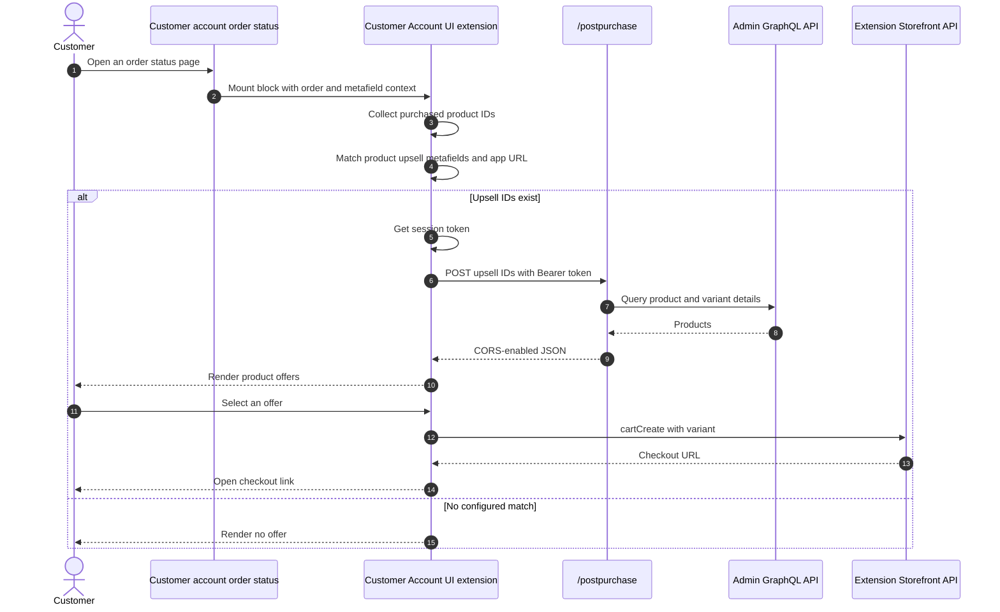

# Customer Account UI

## Purpose

The `/customeraccountui` sample adds an order-status upsell block that creates a new Storefront cart. It is separate from the [standalone Customer Account API login flow](15-storefront.md#customer-login-and-buyer-identity).

## Order Status Sequence

## How It Works

Declared product metafields identify the upsell products; `barebone_app.url` supplies the server URL. The app server verifies the extension session token before product lookup. Cart creation uses the extension's Storefront API access, without exposing an Admin token.

## Common Pitfalls

- Deploy the extension and add the block in the customer-account editor.
- Declare required metafields and capabilities in TOML; definitions alone do not grant access.
- Normalize GIDs and numeric metafield owner IDs before matching.
- Wait for reactive order/metafield data before fetching.
- Network access, CORS, session-token verification, and Storefront API access are separate requirements.

## Source Map

- [Targets and capabilities](../extensions/my-customer-account-ui-ext/shopify.extension.toml)
- [Order-status block](../extensions/my-customer-account-ui-ext/src/OrderStatusBlock.jsx)
- [Shared product lookup](../app/lib/post-purchase.server.js)

## Official Shopify References

- [Customer Account UI extensions](https://shopify.dev/docs/api/customer-account-ui-extensions/unstable)
- [Order status targets](https://shopify.dev/docs/api/customer-account-ui-extensions/unstable/targets/order-status)
- [Metafields API](https://shopify.dev/docs/api/customer-account-ui-extensions/unstable/target-apis/order-apis/metafields-api)
- [Session Token API](https://shopify.dev/docs/api/customer-account-ui-extensions/unstable/target-apis/platform-apis/session-token-api)
- [Storefront API target API](https://shopify.dev/docs/api/customer-account-ui-extensions/unstable/target-apis/platform-apis/storefront-api)
- [Migrate Customer Account UI extensions to web components](https://shopify.dev/docs/apps/build/customer-accounts/migrate-to-web-components)
