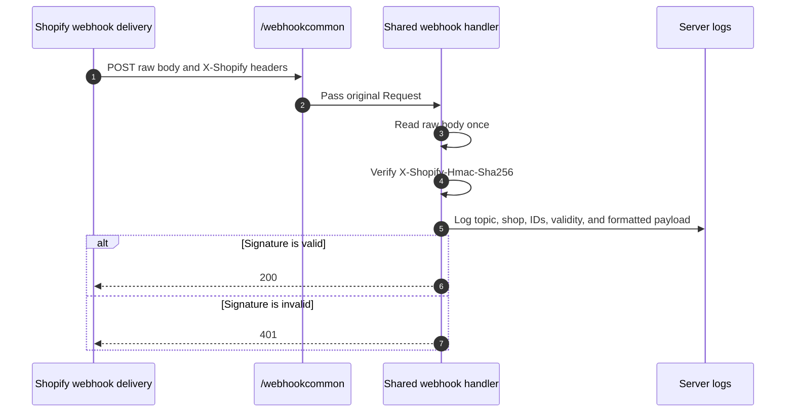

# Event Subscription and Webhooks

## Purpose

The `/eventsubscription` sample receives classic Shopify webhooks. The Events developer preview is linked for reference and is not implemented.

## Webhook Sequence



## Example App Configuration

Example app TOML subscription (choose the topics your app needs):

```toml
[[webhooks.subscriptions]]
topics = [ "inventory_levels/update", "carts/update", "carts/create" ]
uri = "/webhookcommon"
compliance_topics = [ "customers/data_request", "customers/redact", "shop/redact" ]
```

## Receivers in This Sample

| Endpoint | Role |
| --- | --- |
| `/webhookcommon`, `/webhookgdpr` | Shared operational/compliance receiver |
| `/fulfillment_order_notification` | Acknowledge and process fulfillment-service requests |
| `/flowaction` | Compatibility receiver; no Flow extension is configured |
| `/fetch_tracking_numbers.json`, `/fetch_stock.json` | Fulfillment-service callbacks, not webhook subscriptions |

## How It Works

The shared handler verifies raw-body HMAC, logs valid deliveries, and returns `200`; invalid signatures return `401`.

The [fulfillment-service workflow](13-ordermanage.md#fulfillment-request-and-delivery-sequence) acknowledges first, then simulates fulfillment and delivery with in-process delays.

## Common Pitfalls

- Preserve raw bytes for HMAC verification before parsing JSON.
- Acknowledge quickly; persist production work in a durable queue before responding.
- Deduplicate retries by webhook/event ID; the demo is not a durable processing system.
- Full payload logs can expose customer and compliance data; restrict logging in production.
- Deploy app configuration to publish subscription changes. Choose topics, scopes, filters, and API version for your own data flow.

## Source Map

- [Configuration example](../app/pages/EventSubscription.jsx)
- [Webhook route](../app/routes/webhook-action.jsx)
- [Verification and callback handlers](../app/lib/public-endpoints.server.js)

## Official Shopify References

- [About Events and webhooks](https://shopify.dev/docs/apps/build/events-webhooks)
- [Configure app-specific webhook subscriptions](https://shopify.dev/docs/apps/build/webhooks/subscribe)
- [Verify webhook deliveries](https://shopify.dev/docs/apps/build/webhooks/verify-deliveries)
- [Mandatory compliance webhooks](https://shopify.dev/docs/apps/build/privacy-law-compliance)
