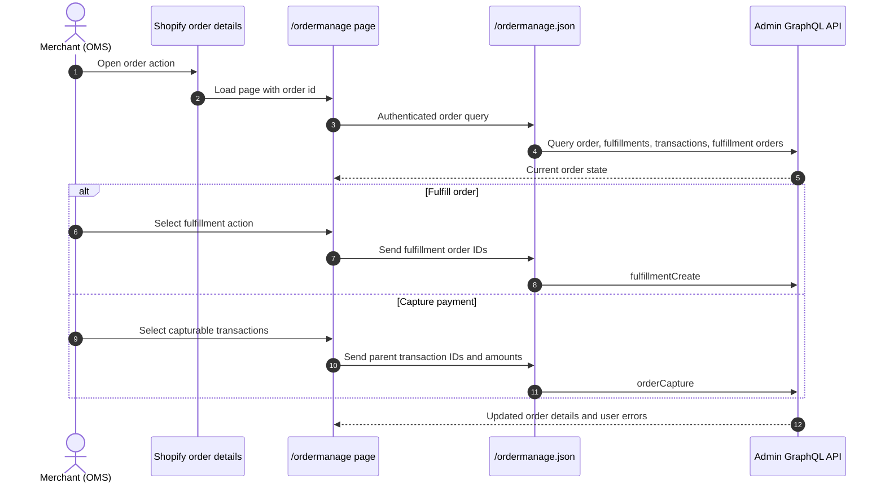
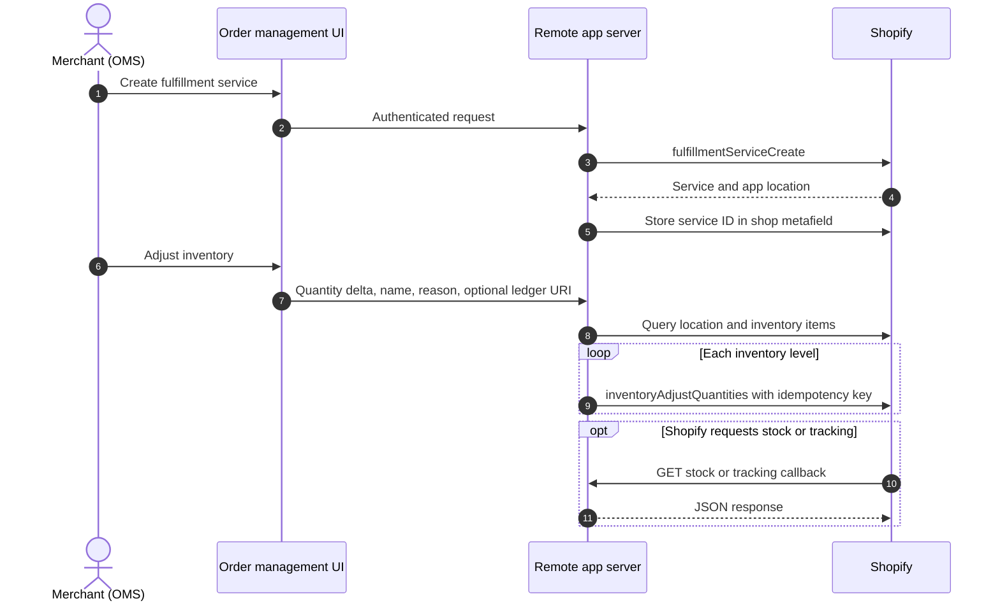
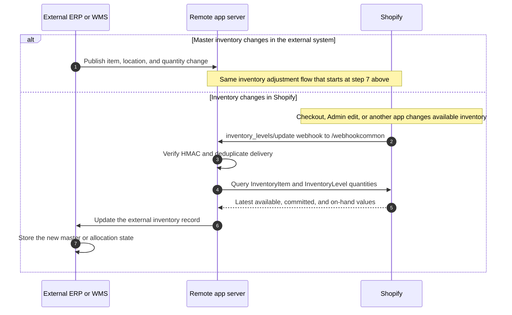
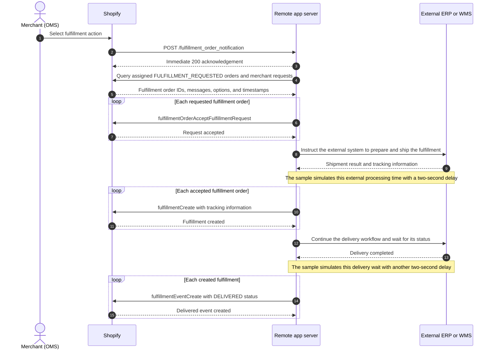

# Order Management

## Purpose

The `/ordermanage` sample covers fulfillment, payment capture, fulfillment-service registration, and inventory updates through server-side Admin API calls.

## Order Action Sequence

An order Admin Link opens the sample. An external OMS can use the same server-side fulfillment and capture operations.

## Fulfillment Service Sequence

A [fulfillment service](https://shopify.dev/docs/apps/build/orders-fulfillment/fulfillment-service-apps) creates an app-managed location and delegates fulfillment to an external ERP, WMS, or OMS. Assign product inventory to that location before testing.

## External ERP Inventory Synchronization

When an ERP is the inventory master, synchronize ERP changes to Shopify and Shopify sellable-quantity changes back to the ERP.

Map quantities by inventory item and location IDs. The ERP path reuses the inventory adjustment flow above; deduplicate events and suppress echoes of your own writes.

### TIPS: Inventory Status Transformation

`Available` → `Committed when ordered` → `Removed from on_hand when fulfilled`

Order creation reduces `available` without changing `on_hand`; fulfillment reduces `committed` and `on_hand`. Shopify manages `committed` through orders and fulfillment, not direct inventory adjustments.

Use [`inventory_levels/update`](https://shopify.dev/docs/api/admin-graphql/unstable/enums/WebhookSubscriptionTopic#enums-INVENTORY_LEVELS_UPDATE) as a sellable-quantity notification, then query current quantities. It may not fire for later shipment transitions that leave `available` unchanged; track those by fulfillment order and delivery events.

## Fulfillment Request and Delivery Sequence

Register a fulfillment service first. The merchant's fulfillment action triggers Shopify's callback; the optional request message is available in `merchantRequests`.

The sample accepts requests, then simulates fulfillment and delivery with short delays. Correlate real external jobs by fulfillment order ID. A callback `200` acknowledges receipt; Admin API mutations change shipment state.

## How It Works

Fulfillment uses fulfillment order IDs; capture uses eligible authorization transactions and their parent IDs. Inventory changes use [`inventoryAdjustQuantities`](https://shopify.dev/docs/api/admin-graphql/unstable/mutations/inventoryAdjustQuantities) with a UUID idempotency key and [`changeFromQuantity: null`](https://shopify.dev/docs/api/admin-graphql/unstable/input-objects/InventoryChangeInput), which intentionally skips compare-and-set checks.

## Common Pitfalls

- One order can have multiple fulfillment orders and transactions; check each one's eligibility.
- Capture only manually capturable authorizations using the correct parent transaction.
- Match inventory by item and location IDs; SKU alone is insufficient.
- Check adjustment name, reason, and ledger requirements. Omit an optional ledger URI or send `null`, not an empty string.
- Verify callback/webhook HMAC without relying on a browser session.
- Replace demo delays with durable, idempotent jobs before production.
- Deduplicate inventory events and prevent webhook-driven synchronization loops.

## Source Map

- [Management UI](../app/pages/OrderManage.jsx)
- [Order, capture, and inventory operations](../app/lib/order-manage.server.js)
- [Fulfillment and webhook callbacks](../app/lib/public-endpoints.server.js)
- [Order Admin Link](../extensions/my-admin-link-order-details/shopify.extension.toml)

## Official Shopify References

- [Fulfillment apps](https://shopify.dev/docs/apps/build/orders-fulfillment/fulfillment-service-apps)
- [Build for fulfillment services](https://shopify.dev/docs/apps/build/orders-fulfillment/fulfillment-service-apps/build-for-fulfillment-services)
- [Inventory management apps](https://shopify.dev/docs/apps/build/orders-fulfillment/inventory-management-apps)
- [Manage inventory quantities and states](https://shopify.dev/docs/apps/build/orders-fulfillment/inventory-management-apps/manage-quantities-states)
- [Inventory level update webhook topic](https://shopify.dev/docs/api/admin-graphql/unstable/enums/WebhookSubscriptionTopic#enums-INVENTORY_LEVELS_UPDATE)
- [Create a fulfillment](https://shopify.dev/docs/api/admin-graphql/unstable/mutations/fulfillmentCreate)
- [Create a fulfillment event](https://shopify.dev/docs/api/admin-graphql/unstable/mutations/fulfillmentEventCreate)
- [Adjust inventory quantities](https://shopify.dev/docs/api/admin-graphql/unstable/mutations/inventoryAdjustQuantities)
