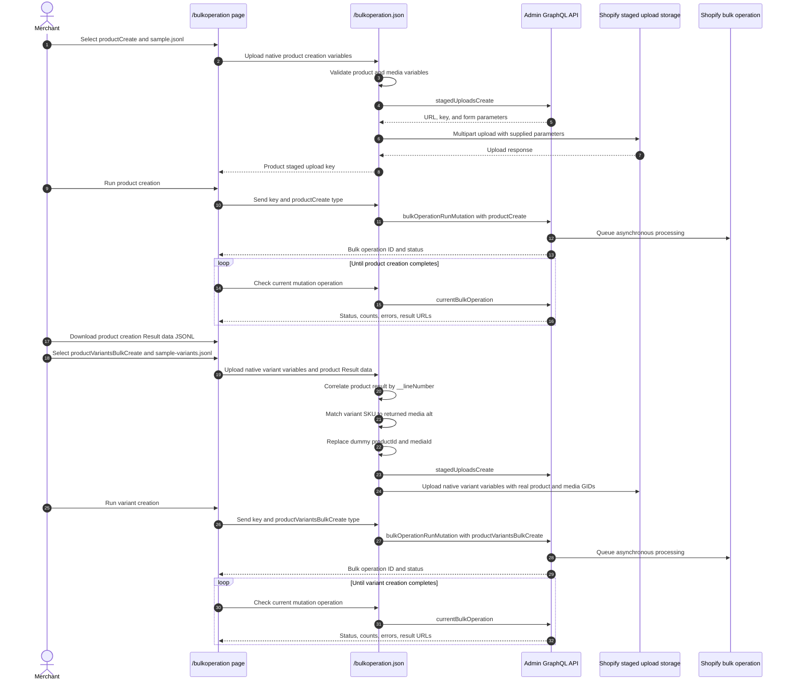

# Bulk Operation

## Purpose

The `/bulkoperation` sample imports products and media, then creates their variants in a second bulk mutation. The first operation must finish before its generated IDs can be used by the second.

## Import Sequence

## How It Works

1. Select **Create products**, upload [sample.jsonl](../app/assets/sample.jsonl), then select **Run the operation**.
2. Wait for completion and download **Result data**.
3. Select **Create product variants**. Upload [sample-variants.jsonl](../app/assets/sample-variants.jsonl) together with that product Result data, then run the operation.
4. Check operation status and per-record errors. Uploading only stages data; starting or cancelling a job is asynchronous.

### Product creation format

Each JSONL line is one `productCreate` variables object: `product` contains the options, and optional `media` entries contain publicly reachable image URLs. Shopify generates the product and media GIDs.

> **Media is public by URL, even for draft or unpublished products.** Do not upload confidential launch assets early; add media near launch with [`productUpdate`](https://shopify.dev/docs/api/admin-graphql/unstable/mutations/productUpdate). Non-descriptive filenames reduce discovery but are not access control.

### Variant creation format

Each line is one `productVariantsBulkCreate` variables object with `productId` and a `variants` array. Keep all variants of one product on that line; every variant selects one value for each product option.

The bundled file uses `/0` placeholders for product and media GIDs. The app replaces them from product Result data before upload. With real IDs, Result data is optional; omit `mediaId` for variants without media. Referenced media must already belong to that product. `REMOVE_STANDALONE_VARIANT` replaces the product's initial variant.

### Product creation Result data

Result data supplies `product.id`, media `id`/`alt`, and zero-based `__lineNumber`. Use output from **product creation**, not the later variant operation.

### JSONL row and array mapping

| Input | One JSONL line contains | Correlation |
| --- | --- | --- |
| Product file | One product, its options, and media URLs | Keep the same product row order as the variant file |
| Product Result data | Generated product/media IDs | `__lineNumber: 0` matches variant line 1 |
| Variant file | One product ID and all its variants | Variant SKU matches media `alt` within that product |

For example, two Sizes × two Colors produce four variant objects in **one** array on the product's line, not four JSONL lines.

**SKU-to-alt matching is sample preprocessing, not Shopify behavior.** Use unique media alt values equal to the planned SKUs. The app resolves explicit `mediaId` values without relying on result or media array order; missing, duplicate, or failed matches are rejected.

## Production-scale imports

This UI processes demonstration-sized files, one at a time. A production importer needs:

- Durable input, operation IDs, stage, and retry state; stream large files instead of loading them into memory.
- Chunks split at complete JSONL lines, within [Shopify's size, duration, and concurrency limits](https://shopify.dev/docs/api/usage/bulk-operations/imports#limitations). Avoid concurrent writes to the same product.
- Completion tracking by [`bulkOperation(id:)`](https://shopify.dev/docs/api/admin-graphql/unstable/queries/bulkOperation) or [`bulk_operations/finish`](https://shopify.dev/docs/api/admin-graphql/unstable/enums/WebhookSubscriptionTopic#enums-BULK_OPERATIONS_FINISH); `currentBulkOperation` is insufficient for parallel jobs. Retain temporary result files before they expire.
- Variant jobs that wait for their matching product chunk. Correlate by chunk/operation ID plus `__lineNumber`, which restarts at zero per file.
- Idempotent retries of failed lines and a durable media key mapping. The sample's SKU-as-alt convention should be replaced or descriptive alt text restored for accessibility.

## Common Pitfalls

- JSONL is one JSON object per line, not a JSON array or a multiline object.
- Use the file format for the selected operation and keep product/variant rows aligned.
- Never send placeholder `/0` IDs to Shopify.
- Product image URLs must be publicly reachable; local files and `localhost` cannot be imported.
- Check immediate `userErrors` and output/partial-data errors; poll with backoff.
- For this React 18 UI, retain standard `input` events and omit inactive boolean attributes; `disabled="false"` still disables an HTML control.

## Source Map

- [Upload and status UI](../app/pages/BulkOperation.jsx)
- [Preprocessing and bulk operations](../app/lib/bulk-operation.server.js)
- [Product input](../app/assets/sample.jsonl) and [variant input](../app/assets/sample-variants.jsonl)

## Official Shopify References

- [Import data with bulk operations](https://shopify.dev/docs/api/usage/bulk-operations/imports)
- [Bulk operation overview](https://shopify.dev/docs/api/usage/bulk-operations)
- [Run a bulk mutation](https://shopify.dev/docs/api/admin-graphql/unstable/mutations/bulkOperationRunMutation)
- [Create a product with `productCreate`](https://shopify.dev/docs/api/admin-graphql/unstable/mutations/productCreate)
- [`ProductCreateInput`](https://shopify.dev/docs/api/admin-graphql/unstable/input-objects/ProductCreateInput)
- [`CreateMediaInput`](https://shopify.dev/docs/api/admin-graphql/unstable/input-objects/CreateMediaInput)
- [`ProductOption` reference](https://shopify.dev/docs/api/admin-graphql/unstable/objects/ProductOption)
- [`ProductVariant` reference](https://shopify.dev/docs/api/admin-graphql/unstable/objects/ProductVariant)
- [Create product variants with `productVariantsBulkCreate`](https://shopify.dev/docs/api/admin-graphql/unstable/mutations/productVariantsBulkCreate)
- [`ProductVariantsBulkInput`](https://shopify.dev/docs/api/admin-graphql/unstable/input-objects/ProductVariantsBulkInput)
- [Manage media for products and variants](https://shopify.dev/docs/apps/build/product-merchandising/products-and-collections/manage-media)
