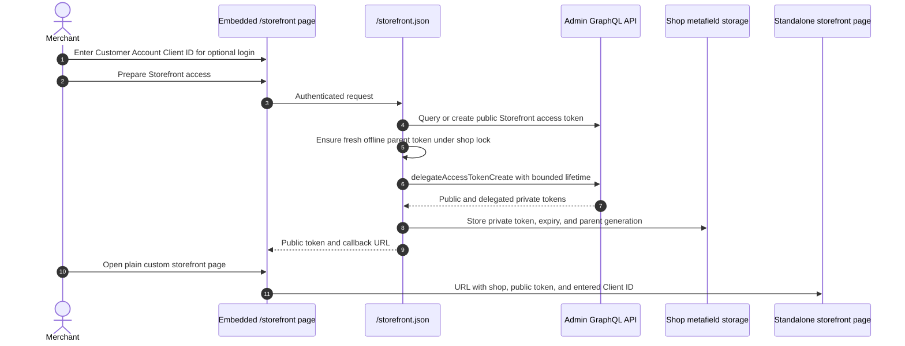
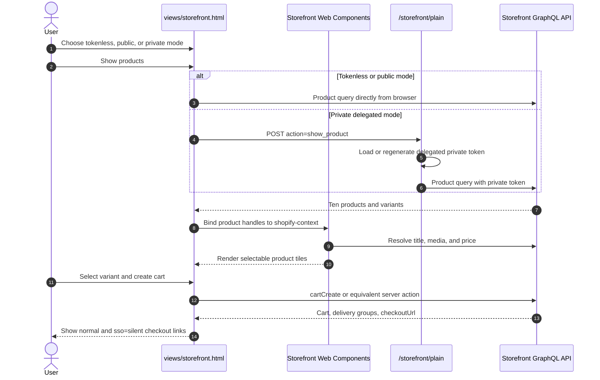
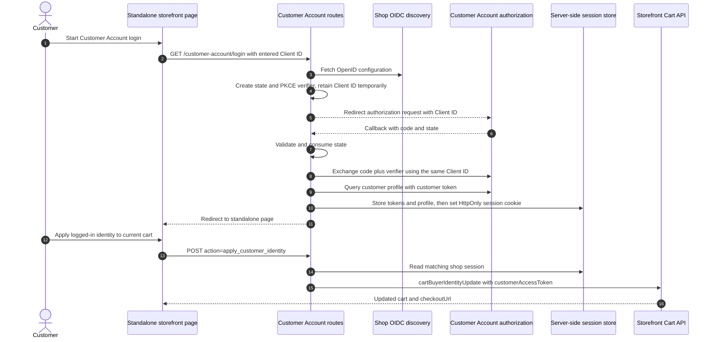

# Storefront API

## Purpose

The `/storefront` sample opens a plain HTML storefront comparing tokenless, public-token, and server-side private-token access. It includes cart operations, Storefront Web Components, and optional Customer Account API login.

## Access Preparation

### Delegated Token Lifecycle

Private tokens cannot outlive the parent Admin token. The server refreshes the parent when needed and regenerates delegated tokens near expiry or when the parent changes, under a per-shop lock. Run **Prepare Storefront access** once before using this mode.

See the [offline refresh sequence](00-ARCHITECTURE.md#offline-token-refresh-before-api-use) and [delegated-token helper](../app/lib/delegated-token.server.js).

## Product and Cart Sequence

## Customer Login and Buyer Identity

## How It Works

The page defaults to public-token mode because password-protected development stores can reject tokenless access. Private calls stay on the app server. Product tiles use [Storefront Web Components](https://shopify.dev/docs/api/storefront-web-components); cart actions use explicit GraphQL mutations.

To enable customer login:

1. Open **Headless** from the management page and create a storefront with a public Customer Account API client.
2. Register the displayed `/customer-account/callback` URL and JavaScript origin in that client's settings.
3. Enter its Client ID in the management page. This is separate from the app API key; it is passed in the page URL and must be re-entered after reload. No environment-variable fallback is used.

The server handles PKCE/OIDC login and stores customer credentials behind an HttpOnly session cookie. Apply the logged-in identity to the cart explicitly; login alone does not update it. Without a Client ID, product and cart samples still work. See the [official setup guide](https://shopify.dev/docs/storefronts/headless/building-with-the-customer-account-api/getting-started).

## Common Pitfalls

- Run **Prepare Storefront access** before token-based calls. An Online Store password can block tokenless access.
- Keep private tokens out of HTML, URLs, JavaScript, and browser storage.
- Use a Customer Account API client for the same store and its own token/header conventions, not Admin OAuth conventions.
- Refresh cart delivery choices after buyer identity or address changes; country and language affect results.
- The `sso=silent` checkout link uses an existing Customer Accounts browser session independently of the cart's stored buyer identity.

## Source Map

- [Preparation UI](../app/pages/Storefront.jsx) and [plain storefront](../views/storefront.html)
- [Storefront and cart operations](../app/lib/storefront.server.js)
- [Delegated token management](../app/lib/delegated-token.server.js)
- [Customer login and session](../app/lib/customer-account.server.js)

## Official Shopify References

- [Storefront API](https://shopify.dev/docs/api/storefront/unstable)
- [Storefront API access](https://shopify.dev/docs/api/usage/authentication#storefront-api-access-tokens)
- [Storefront Cart API](https://shopify.dev/docs/storefronts/headless/building-with-the-storefront-api/cart)
- [Storefront Web Components](https://shopify.dev/docs/api/storefront-web-components)
- [Customer Account API](https://shopify.dev/docs/api/customer/unstable)
- [Get started with Customer Account API](https://shopify.dev/docs/storefronts/headless/building-with-the-customer-account-api/getting-started)
- [Authenticate buyers in checkout](https://shopify.dev/docs/storefronts/headless/building-with-the-customer-account-api/checkout-authentication)
