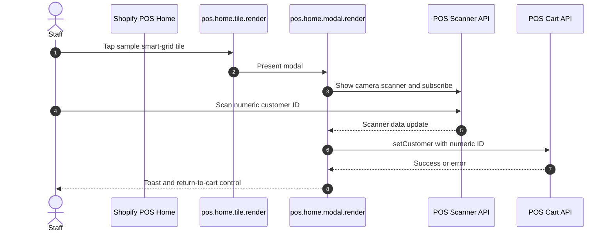
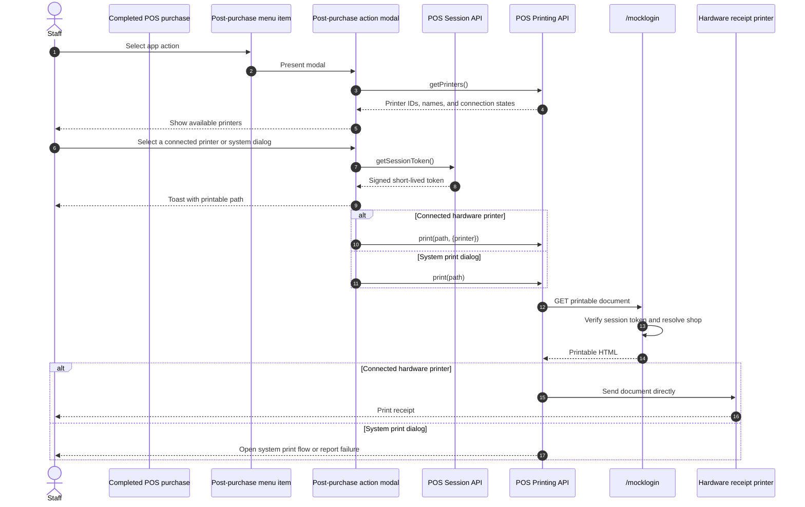

# POS UI

## Purpose

The `/posui` sample scans a numeric Shopify customer ID into the cart and prints an authenticated app-hosted document after a sale.

## Prerequisites

1. Install the [Shopify POS channel](https://apps.shopify.com/shopify-pos) and POS mobile app ([iOS](https://apps.apple.com/us/app/shopify-point-of-sale-pos/id686830644) / [Android](https://play.google.com/store/apps/details?id=com.shopify.pos)); sign in to the sample's store.
2. Deploy the extension and add **A Preact POS UI extension** to the smart grid in POS or the Admin POS editor. The editor listing uses the TOML description; the running tile has its own heading.

## Scanner Sequence

## Printing Sequence

## How It Works

The scanner modal assigns a numeric customer ID to the cart and releases scanner subscriptions when closed.

The post-purchase modal lists hardware printers. A connected printer uses `printing.print(path, {printer})` for direct output; `printing.print(path)` opens the system dialog. Both request `/mocklogin` with a fresh POS session token.

> **Test stores only:** The printed demo exposes the stored Admin token. Remove that display in production; do not share its URL or printouts.

In this sample's testing, system preview worked on iPad but stalled on iPhone. A compatible hardware printer bypasses that dialog; preview behavior still depends on the device.

## Common Pitfalls

- Configure both the entry target and its companion modal.
- Validate numeric customer IDs; unsubscribe and hide the scanner when closing.
- Verify fresh session tokens on the server. Query-string tokens can leak through logs.
- `getPrinters()` lists hardware only; an empty list does not rule out system printing.
- Direct hardware printing supports HTML/images, not PDFs. Handle rejected print requests and show status.

## Source Map

- [POS targets](../extensions/my-pos-ui-ext/shopify.extension.toml)
- [Scanner modal](../extensions/my-pos-ui-ext/src/Modal.jsx)
- [Printing modal](../extensions/my-pos-ui-ext/src/PostPurchaseActionModal.jsx)
- [Authenticated print document](../app/lib/public-endpoints.server.js)

## Official Shopify References

- [POS UI extensions](https://shopify.dev/docs/api/pos-ui-extensions/unstable)
- [POS Home screen targets](https://shopify.dev/docs/api/pos-ui-extensions/unstable/targets/home-screen)
- [POS post-purchase targets](https://shopify.dev/docs/api/pos-ui-extensions/unstable/targets/post-purchase)
- [Scanner API](https://shopify.dev/docs/api/pos-ui-extensions/unstable/target-apis/platform-apis/scanner-api)
- [Cart API](https://shopify.dev/docs/api/pos-ui-extensions/unstable/target-apis/contextual-apis/cart-api)
- [Session API](https://shopify.dev/docs/api/pos-ui-extensions/unstable/target-apis/standard-apis/session-api)
- [Printing API](https://shopify.dev/docs/api/pos-ui-extensions/unstable/target-apis/platform-apis/printing-api)
- [Direct hardware receipt printer changelog](https://shopify.dev/changelog/pos-ui-extensions-can-now-print-directly-to-hardware-receipt-printers)
- [Upgrade POS UI extensions to 2025-10](https://shopify.dev/docs/apps/build/pos/upgrading-to-2025-10)
